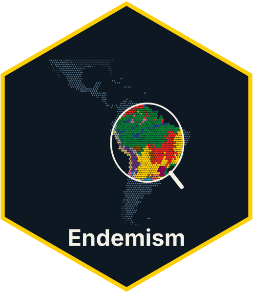

<!-- README.md is generated from README.Rmd. Please edit that file -->

# Endemism 

<!-- badges: start -->

[](https://choosealicense.com/licenses/gpl-2.0/)
<!-- badges: end -->

<p align="left">

• <a href="#overview">Overview</a><br> •
<a href="#features">Features</a><br> •
<a href="#content">Content</a><br> •
<a href="#installation">Installation</a><br> •
<a href="#usage">Usage</a><br> • <a href="#citation">Citation</a><br> •
<a href="#contributing">Contributing</a><br> •
<a href="#acknowledgments">Acknowledgments</a><br> •
<a href="#references">References</a>
</p>

## Overview

This research compendium contains the code behind the paper **“A biome
lens is critical to understanding tree endemism across tropical
America”**.

We compiled herbarium occurrence records of all tree species of the
Americas (GBIF, JABOT, REFLORA and speciesLink), cleaned them with
[plantR](https://github.com/LimaRAF/plantR), and assigned each record to
one of 21 tropical American biomes, defined as IUCN Global Ecosystem
Typology functional groups (EFGs; Keith et al. 2022) mapped from the
terrestrial ecoregions of Dinerstein et al. (2017) within the
Neotropical region of Morrone et al. (2022). From these records we (i)
build checklists of tree richness and endemism per biome, (ii) map
weighted endemism (WE) at 0.5° (~50 km), interpolated by ordinary
kriging, (iii) delimit critical centers of endemism, and (iv) model the
accumulation of species descriptions through time.

## Features

The main purpose of this compendium is to reproduce, from raw downloads
to final figures and tables, all results of the paper:

- **Taxonomy:** species names come from the companion repository
  [SynTreeSys/Taxonomy](https://github.com/synTreeSys/Taxonomy), copied
  here as `data/derived-data/checklist_species_level.rds`.
- **Record cleaning:** plantR workflow (name, locality, coordinate and
  collector standardisation; duplicate removal; `checkDist` against WCVP
  native ranges; robust Mahalanobis outliers).
- **Biome assignment:** ecoregions converted into EFGs through a
  classification table built by SynTreeSys members.
- **Endemism:** endemism levels per biome, weighted endemism with a null
  model, rarefaction and kriging, critical centers of endemism (cells
  with kriged WE values above the 90th percentile).
- **Species discovery:** description curve of tropical American
  endemics.
- **Reproducible numbers:** every script writes the values it reports to
  `outputs/numbers/*.csv`, joined into
  `outputs/tables/manuscript_numbers.xlsx`.

## Content

This repository is structured as follow:

- [`DESCRIPTION`](https://github.com/ggrittz/Endemism/tree/master/DESCRIPTION):
  contains project metadata (authors, date, dependencies, etc.)

- [`make.R`](https://github.com/ggrittz/Endemism/tree/master/make.R):
  main R script to run the entire project

- [`R/`](https://github.com/ggrittz/Endemism/tree/master/R): contains the
  R functions used by the scripts: weighted endemism (`99_WE.R`) and its
  null model (`99_WE_null_test.R`), slightly modified from Guerin et al.
  (2015), and the species accumulation per cell used before kriging
  (`internals.R`)

- [`analyses/`](https://github.com/ggrittz/Endemism/tree/master/analyses):
  numbered R scripts of the workflow (see [Usage](#usage)); `00_*`
  download the raw data, `99_*` are auxiliary scripts (bash downloads,
  gazetteer and taxonomist dictionaries, climate of ecoregions)

- `data/raw-data/`: raw downloads (GBIF, JABOT, REFLORA, speciesLink,
  WCVP, WFO, ecoregions 2017, Morrone 2022, WDPA, plantR gazetteer). Not
  versioned (too large); see [Usage](#usage) for how to obtain them

- `data/derived-data/`: intermediate files written by the scripts
  (cleaned records per family in `Cleaned_occs/`, records used for
  endemism in `Endemic_species/`, maps in `maps/`, R objects in `rds/`).
  Not versioned

- [`outputs/`](https://github.com/ggrittz/Endemism/tree/master/outputs):

  - `numbers/`: values reported in the paper, one csv per script
  - `tables/`: summary tables and checklists (.xlsx)
  - `PNAS_manuscript/`: submission files (Figures 1-3 and S1-S6 as PDF,
    Datasets S1-S6, `references.bib`)
  - `PNAS_manuscript/zenodo/`: the data deposit (`01_maps`,
    `02_records`, `03_datasets`, `README.txt`), archived on Zenodo (DOI:
    **\[add later\]**)

- [`figures/`](https://github.com/ggrittz/Endemism/tree/master/figures):
  figures written by the scripts (svg, png and pdf)

## Installation

To install this compendium:

- [Fork](https://docs.github.com/en/get-started/quickstart/contributing-to-projects)
  this repository using the GitHub interface.
- [Clone](https://docs.github.com/en/repositories/creating-and-managing-repositories/cloning-a-repository)
  your fork using `git clone fork-url` (replace `fork-url` by the URL of
  your fork). Alternatively, open [RStudio
  IDE](https://posit.co/products/open-source/rstudio/) and create a New
  Project from Version Control.

**Requirements**

- R \>= 4.5 (developed with R 4.5.1)
- plantR (GitHub version, commit `b312b7a`):
  `remotes::install_github("LimaRAF/plantR@b312b7a")`
- plantRdata 0.0.11 and rWCVPdata 0.8.0
- Other packages (installed from `DESCRIPTION` by `make.R`): terra, sf,
  gstat, automap, ConR, data.table, dplyr, tidyr, arrow, ggplot2,
  cowplot, ggspatial, MetroBrewer, nls.multstart, propagate,
  countrycode, readxl, writexl, googlesheets4, here
- A bash shell with `awk` (used to split the GBIF download by family)
- ~**\[add\]** GB of free disk space for raw and derived data

## Usage

Launch the
[`make.R`](https://github.com/ggrittz/Endemism/tree/master/make.R) file
with:

``` r
source("make.R")
```

**Notes**

- All required packages listed in the `DESCRIPTION` file will be
  installed (if necessary)
- All required packages and R functions will be loaded
- Some analyses listed in the `make.R` might take time

**Input data.** Before running, place the raw downloads in
`data/raw-data/`: the GBIF download (DOI:
<https://doi.org/10.15468/DL.E39T7B>), JABOT and REFLORA IPT downloads
(`analyses/00_dl_jabot_data.R`, `analyses/00_dl_reflora_data.R`),
speciesLink (`analyses/99_bash_specieslink_occurrence.sh`), the Flora e
Funga do Brasil vouchers (`analyses/00_prepare_ffb_vouchers.R`), and the
maps listed in `analyses/03_prepare_TAmap.R`. The species list
(`checklist_species_level.rds`) comes from SynTreeSys/Taxonomy. `make.R`
downloads the ecoregion -\> EFG table from Google Sheets (requires
authentication with access to the sheet).

**Workflow** (run in this order):

| Script | What it does | Main outputs |
|----|----|----|
| `01_prepare_{gbif,jabot,reflora,splink}_data.R` | Filter records to the tree list and clean them with plantR, family by family | `data/derived-data/*_occ/` |
| `02_removing_duplicates.R` | Merge the four sources and remove duplicates | `Cleaned_occs/`, `outputs/n_registers_log.txt` |
| `03_prepare_TAmap.R` | Build the map of tropical American biomes (ecoregions -\> EFGs) | `maps/NTAmericas_*` |
| `04_crossing_maps.R` | Cross administrative units (GADM) with biomes | `maps/latamMap_classified.gpkg` |
| `05_endemism_levels.R` | Validate records (checkDist, outliers) and assign biome endemism levels | `Endemic_species/` (emptied at start) |
| `06_calculate_wee.R` | Weighted endemism at 0.5° and null model | `rds/we_map_area_*`, `rds/final_df.rds` |
| `07_rarefy_interpolate_new.R` | Sampling completeness per cell (species accumulation curves) and ordinary kriging of WE and richness | `maps/interpolated_maps_*50km.tiff` |
| `08_preparing_plots.R` | Figures 1-3, S3-S6, WE vs effort, critical centers of endemism | `figures/`, `outputs/tables/` |
| `09_preparing_extra_records.R` | Records outside the spatial dataset that can enter the checklist by administrative unit | `rds/supp_data_for_endemics.rds` |
| `10_preparing_checklist.R` | Checklists of richness and endemism per biome, Figure S1 | `outputs/tables/checklist_*`, `endemics_by_nt.xlsx` |
| `11_species_accumulation.R` | Description curve of tropical American endemics, Figure S2 | `figures/FigureS2.*` |
| `12_manuscript_numbers.R` | Join all reported values in one table | `outputs/tables/manuscript_numbers.xlsx` |
| `13_zenodo_export.R` | Export maps, records and datasets for the Zenodo deposit | `outputs/zenodo/` |

`99_ecoregion_climate_efg.R` (TerraClimate water deficit per ecoregion)
is not part of the main run; it documents how the dry forest (T1.2)
vs. thorny desert (T5.2) borderline was decided.

Random steps use `set.seed(2026)`.

## Citation

Please use the following citation:

> Grittz GS, **\[co-authors\]** (2027) A biome lens is critical to
> understanding tree endemism across tropical America. *In review*.

Data: **\[Zenodo DOI, add later\]**

## Contributing

All types of contributions are encouraged and valued. For more
information, check out our [Contributor
Guidelines](https://github.com/ggrittz/Endemism/blob/main/CONTRIBUTING.md).

Please note that this project is released with a [Contributor Code of
Conduct](https://contributor-covenant.org/version/2/1/CODE_OF_CONDUCT.html).
By contributing to this project, you agree to abide by its terms.

Contact: Guilherme S. Grittz (<ggrittz@usp.br>).

## Acknowledgments

G.S.G. was funded by the São Paulo Research Foundation (FAPESP, grant
2024/22166-2). We thank the herbaria and data portals (GBIF, JABOT,
REFLORA, speciesLink) that make their collections available, and the
SynTreeSys members who classified the ecoregions into biomes.

## References

- Guerin GR, Ruokolainen L, Lowe AJ (2015) A georeferenced implementation of
  weighted endemism. *Methods in Ecology and Evolution* 6:845-852.
  https://doi.org/10.1111/2041-210X.12361
- Dinerstein E et al. (2017) An ecoregion-based approach to protecting
  half the terrestrial realm. *BioScience* 67:534-545.
- Keith DA et al. (2022) A function-based typology for Earth’s
  ecosystems. *Nature* 610:513-518.
- Morrone JJ et al. (2022) An updated regionalization of the Neotropical
  region. *Anais da Academia Brasileira de Ciências* 94:e20211167.
- de Lima RAF et al. (2023) plantR: an R package and workflow for
  managing species records from biological collections. *Methods in
  Ecology and Evolution* 14:332-339.
